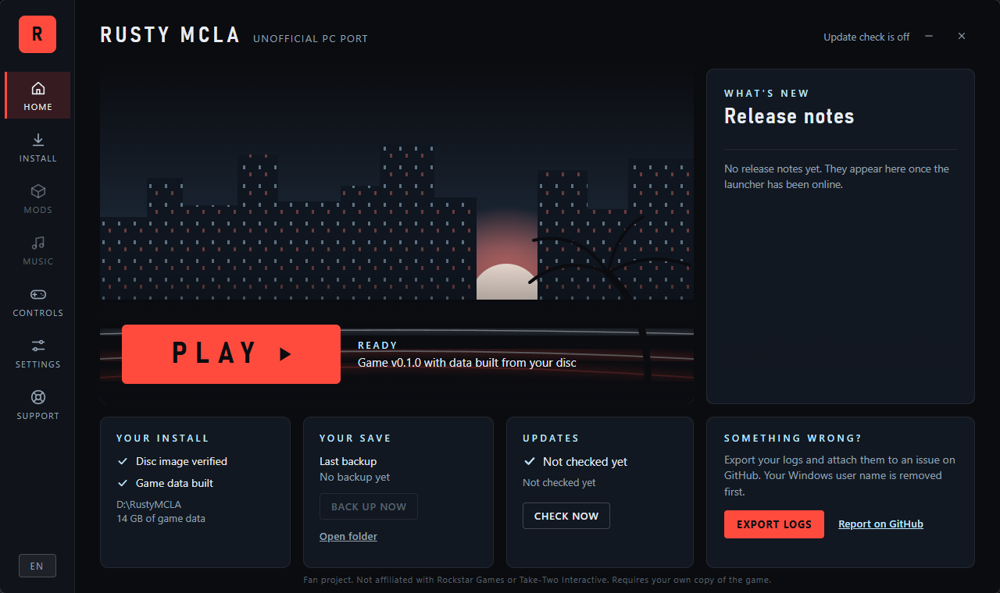

# Rusty MCLA

An unofficial port of *Midnight Club: Los Angeles* (Complete Edition), written in Rust.

> **Android port:** Experimental ARM64 work is maintained on this branch. See the Android build and test notes; game data must be user-supplied.

It is a new game engine that reads the original game's own data from **your copy of the disc** and runs the game natively on PC
(Vulkan, DirectX 12 and Metal through wgpu). The original game's data is not included in this repository. The Android test install uses data converted separately from the tester's own copy of the game.

> **Status: early development.** The game runs from data extracted from a disc image, and the launcher that will automate the
> setup is being built. There is no stable release yet.

## What you need

- **Your own copy of the game:** a disc image (`.iso`) of the Xbox 360 *Midnight Club: Los Angeles, Complete Edition (USA, Europe)*,
  legally obtained. This project does not provide it, does not help find it, and will not accept requests for it.
- Windows 10 or 11 (Linux and macOS are planned).
- A graphics card with Vulkan or DirectX 12 support, and enough free disk space for the game data built from your disc.

## How it will work

1. Download the launcher from the Releases page. It is one portable file: put it in a folder of your choice.
2. Start it, choose your disc image, and let it build the game data into that folder. This is done once, on your computer.
3. Press Play. The launcher shows the latest release notes and offers updates, which you can always skip.

The launcher is built in this repository (`launcher/`): themes, language support, settings and logs are in; the disc setup,
updates, log export and save manager are next.

## What works today

Most of the game is in: the city, cars and the garage, the vehicle physics, the front end and menus, the minimap, career missions
and races, police and rivals, audio and cutscenes. Details that differ from the original, and what is still open, are tracked by the project.

Postponed for later: online play, custom music (including Spotify), car mods, controller rumble and adaptive triggers, racing wheels.

## Building from source

- The game and tools: `mcla-rs/` (Rust stable; the GNU target on Windows). See `mcla-rs/README.md`.
- The launcher: `launcher/` (Tauri 2; the MSVC toolchain with a static runtime, so it ships as a single exe). See `launcher/README.md`.

## Reporting problems

Open an issue. The launcher's Support tab can export a log file for you to attach (your Windows user name is removed first). Please only submit issues for crashes at this state of the game, others will be closed at this state. There will be MANY bugs that will eventually be worked out as progress keeps getting made. This request will change once more progress is made.
Please **do not post or ask for game files or disc images** in issues.

## Licence and notice

The code is licensed under the **GNU General Public License, version 3 only** (see `LICENSE`). Contributions are accepted under the same licence.
The licences of the third-party software compiled into the programs are listed in [`THIRD-PARTY-NOTICES.md`](THIRD-PARTY-NOTICES.md). The Android branch contains a tester-supplied cover image used by its launcher. Its rights have not been independently verified, and the code licence does not grant rights to third-party game names or artwork. If you hold rights to material here, please open an issue so it can be reviewed.

This is an unofficial fan project. It is not affiliated with, authorised or endorsed by Rockstar Games or Take-Two Interactive.
"Midnight Club" and "Midnight Club: Los Angeles" and related names and artwork belong to their owners and are used here only to say which game this
project works with. No original game data, audio or video is distributed in this repository, and no game-specific keys: the only key material in the source is two public console constants (the Xbox 360 retail XEX key and the PS3 save-data key); the game's own key is derived on your machine from your own copy.
