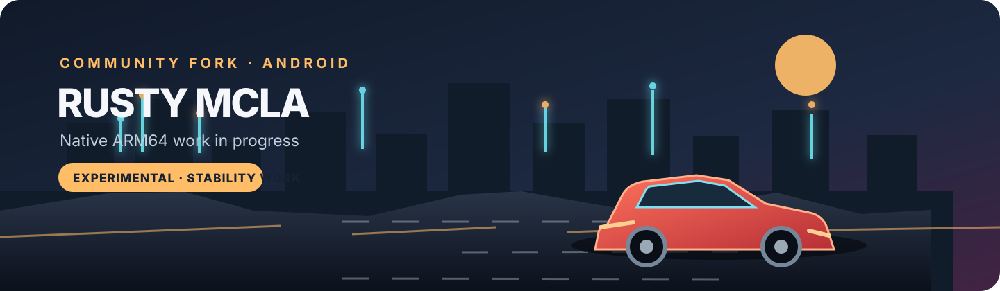

# Rusty MCLA · Android fork

<p align="center">
  
</p>

<p align="center">
  <a href="https://github.com/holdmysocks/rusty-mcla">Upstream project</a> ·
  <a href="https://github.com/gabrielbskk/rusty-mcla/tree/android-experimental/android-game">Android source and build</a> ·
  <a href="android-game/TESTING-STATUS.md">Test status</a>
</p>

<p align="center">
  
  
  
  
</p>

This public fork focuses on adapting the Rusty MCLA engine to Android. It is an
unofficial project for **Midnight Club: Los Angeles Complete Edition**. The
Android build targets native `arm64-v8a` and uses wgpu with the device's system
Vulkan or OpenGL ES backend.

> [!WARNING]
> This is an experimental test build, not a stable release. The game has reached
> gameplay on one Android 16 phone, but the latest saved diagnostics show about
> 0.5–0.6 FPS during a sustained run; an earlier run recorded an input ANR. A
> successful compile, install, or launch does not mean the game is playable.

## Android work in this fork

- Rust engine compiled for `aarch64-linux-android` (`arm64-v8a`).
- wgpu can use Android's system Vulkan or GLES backend; no vendor driver is
  bundled in the APK.
- Android setup screen with graphics preset, render scale, blur, effects,
  pedestrian density, draw distance, and frame cap controls.
- Touch controls and an Android gamepad bridge are present; physical gamepad
  behavior still needs verification.
- Loading progress, frame/sector diagnostics, and exportable text reports help
  investigate startup stalls and ANRs.
- Game data stays outside the APK and must be prepared from the user's own
  legally obtained copy.

See [Android build instructions](android-game/README.md) and the
[current test report](android-game/TESTING-STATUS.md) for the actual limits and
verification state.

## Build

The Android build script and requirements are in [`android-game/`](android-game/).
For a Termux build, configure the Android Rust target, SDK tools, NDK/Clang, and
the local converted game data as described there. The standard Android artifact
is generated locally; APKs, signing keys, converted game data, and raw device
diagnostics are not checked into this repository.

```sh
cd mcla-rs
cargo build -p mcla --lib --target aarch64-linux-android --release --features android-fps-counter
```

## Upstream and scope

This repository is a fork of [`holdmysocks/rusty-mcla`](https://github.com/holdmysocks/rusty-mcla).
The upstream project also supports its original desktop targets. This branch
keeps that shared engine while concentrating its changes, packaging, and testing
on Android. Android-specific changes are developed on
[`android-experimental`](https://github.com/gabrielbskk/rusty-mcla/tree/android-experimental).

## Game data, license, and notices

The repository does not distribute the commercial game, its converted data,
audio, video, or keys. Supply and convert your own legally obtained game copy.
The project is not affiliated with or endorsed by Rockstar Games or Take-Two
Interactive. Game names and marks belong to their respective owners.

Project code is licensed under GPL-3.0-only. See [`LICENSE`](LICENSE) and
[`THIRD-PARTY-NOTICES.md`](THIRD-PARTY-NOTICES.md) for details. The Android
launcher artwork in this fork is an original vector asset.

## AI-assisted development

I used AI assistance for a substantial part of this port. I apologize for using
it on work that still has this many gaps, and for the mistakes or extra work
that may result. AI alone has not been capable of completing and validating a
port of this complexity; the code and results still need careful human review
and real-device testing. Thank you for your patience while I keep working
through it step by step.
